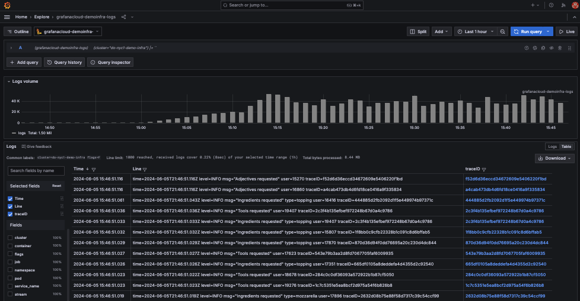
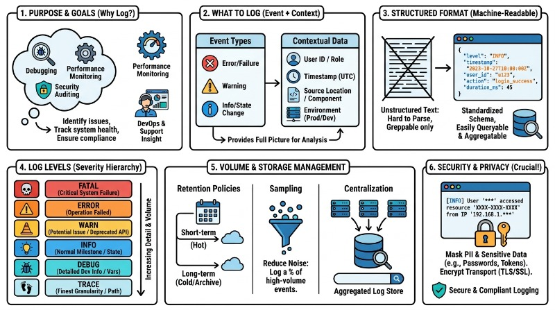
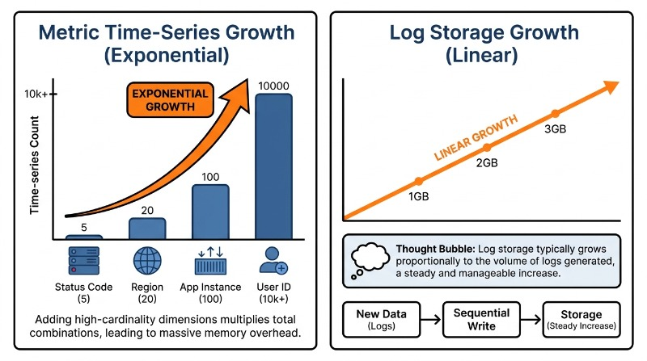

# Logging

🔑 **Key points**

- Logs provide the context and granular detail that metrics lack.
- Logging architecture significantly impacts application performance and reliability.

---

Metrics provide a high-level overview of system health, but you often need to dig into specific details to understand the root cause of an issue. For example, metrics might show that request latency is increasing, but they won't explain *why*. Is the delay caused by a single long-running request, a specific user's activity, or a bottleneck on a particular server?

A robust logging system records individual events, tagging them with metadata that allows you to aggregate and filter related data. By using timestamps, you can correlate events across different parts of the system to reconstruct the sequence of actions leading up to an issue.



Many essential logging characteristics were introduced in the [Observability](../observability/observability.md) topic, including centralized aggregation, immutability, the removal of sensitive information (credentials and PII), and performant search capabilities. These factors should guide how you acquire and persist your logs.




## Understanding Cardinality: Logs vs. Metrics

In the world of observability, **cardinality** refers to the number of unique values in a dataset. Understanding the difference in how logs and metrics handle cardinality is essential for building efficient monitoring systems. While logs and metrics both help you understand your system, they serve different purposes based on the "richness" of the data they contain.

### Metrics: The Power of Low Cardinality

Metrics are numerical representations of data measured over intervals of time. They are designed for aggregation. Because metrics are stored as time-series data (e.g., "Requests per second"), they work best with **low cardinality** dimensions. A dimension like `status_code` (which might only have 5 values: 200, 400, 401, 404, 500) is perfect for metrics.

If you attempt to use a **high cardinality** value—such as a `user_id` or `request_id`, as a metric dimension, you create a "cardinality explosion." Every unique ID creates a new time-series that the database must track, leading to massive memory usage and increased storage costs.

### Logs: Embracing High Cardinality

Logs are discrete events. Unlike metrics, which summarize data, logs record the specific details of a single occurrence. Because of this, logs are the natural home for **high cardinality** data. When you need to find out exactly what happened to a specific user during a specific transaction, you look at logs.

| Feature | Metrics | Logs |
| :--- | :--- | :--- |
| **Cardinality** | Low (few unique values) | High (many unique values) |
| **Primary Goal** | Alerting and Trending | Debugging and Forensics |
| **Data Structure** | Aggregated counters/gauges | Individual event strings/JSON |
| **Storage Cost** | Cheap (per metric) | Expensive (per GB of text) |

### Visualizing the Cardinality Explosion

The following chart illustrates how memory overhead in a metrics system grows exponentially as you add dimensions with higher cardinality, compared to the linear growth of log storage.



### Code Example: Metric vs. Log

Consider a web checkout process. Here is how we handle the data differently based on cardinality:

```javascript
// METRIC: Low Cardinality
// We only track the count of successes vs failures.
// This is efficient and easy to graph over time.
statsd.increment('checkout.success', ['region:us-east', 'plan:gold']);

// LOG: High Cardinality
// We include specific IDs that allow us to trace a single person's journey.
// This is invaluable for support and debugging individual errors.
logger.info({
    event: "checkout_completed",
    user_id: "user_9928347",
    order_id: "ord_882734112",
    cart_value: 152.50,
    latency_ms: 450
});
```
```masteryls
{"id":"eed41e21-1a73-438b-9d8b-7e2fe24b0693","title":"Identifying High Cardinality","type":"multiple-choice"}
You are designing an observability strategy for a new e-commerce API. Which of the following data points should be stored as a Log attribute rather than a Metric dimension?

- [ ] The HTTP Status Code (e.g., 200, 404, 500)
  This is a low-cardinality value. Since there are only a few possible status codes, this is ideal for a metric dimension so you can easily graph error rates.
- [ ] The AWS Region (e.g., us-east-1, eu-west-1)
  This is a low-cardinality value. Even large global companies only have a few dozen regions, making this a great candidate for metric filtering.
- [x] The unique Session Token (e.g., a UUID like '550e8400-e29b-41d4...')
  Correct! A session token is high-cardinality because it is unique to every visitor. Putting this in a metric would cause a "cardinality explosion," while putting it in a log allows you to trace a specific user's actions.
- [ ] The Application Environment (e.g., production, staging, dev)
  This is a low-cardinality value. You typically only have a handful of environments, so metrics are perfect for comparing performance between production and staging.
```


## The impact of logging design

An often overlooked aspect of observability is the mechanism used to capture, normalize, and transmit logs. The goal is to report events with minimal lag without degrading the performance of the application itself.

In many simple implementations, log generation and transmission happen synchronously with the event. For example, when an HTTP request is received, the application might attempt to send a log record over the network as part of that request's processing cycle. Even if the transmission is technically handled by a background thread (asynchronously), the overhead of creating the log object and managing the network buffer can still increase customer request latency.

There are several strategies to mitigate this impact:

### Buffering and batching
Instead of sending every log entry individually, you can cache multiple events in memory and transmit them in bulk. For example, you might configure a 500 KB buffer that flushes when it is full or after 15 seconds have passed. This reduces network overhead and allows for better compression, significantly decreasing transmission costs.

### Out-of-process transmission
Another approach is to write logs to local disk or a local pipe, then use a separate process (a "logging agent" or "daemon") to transmit them to the central server. This allows the logging process to run at a lower CPU priority. However, this design has risks:
1. **I/O Overhead:** Writing to and reading from a disk adds processing and latency.
2. **Resource Exhaustion:** If the logging agent falls behind, logs could consume all available disk space, potentially causing the operating system to crash.
3. **CPU Starvation:** If the application is struggling and consuming all CPU resources, the logging process might never get the time it needs to report data—exactly when you need those logs the most.

### Prioritization and sampling
Critical log events are often as important as the user requests themselves. For instance, knowing that request rates are spiking is the only way to trigger the elastic scaling required to maintain service. 

To balance visibility with performance, you can prioritize events. When resources are constrained, you might choose to drop low-priority "Info" logs and only report "Error" logs, or use sampling to report only a percentage of successful events while capturing 100% of failures.

## Additional considerations

When designing your logging strategy, consider the following:

- **Frequency:** How often are events generated?
- **Volume:** How much data is being produced per second?
- **Batching:** Should logs be sent individually or in bulk?
- **Concurrency:** Is logging synchronous (blocking) or asynchronous (non-blocking)?
- **Architecture:** Should logging be handled within the application process or by an external daemon?
- **Transformation:** Can you normalize or truncate data to reduce overhead while maintaining its value?
- **Format:** Are you using a structured format (like JSON) that is easy for machines to parse?
- **Efficiency:** Are you transmitting redundant information that could be derived elsewhere?

Regardless of the specific design, the most important step is to start logging. You can refine the system as your application grows, but without a baseline of log data, you cannot effectively protect your application from failure or security threats.


## ☑ Exercise


```masteryls
{"id":"fc0b7743-74ac-45f2-a6a6-fd4e4fc4b265","title":"Determining Log Volume","type":"multiple-choice"}
When determining the appropriate volume of data to include in application logs, which principle best balances the needs of observability with system constraints?

- [ ] Log every variable change and function entry/exit point in production to ensure total visibility into the execution flow.
  Wanting complete visibility makes sense. More data can feel safer.

  In production, though, logging every variable and function call creates huge volume, raises costs, and slows the application. The lesson warns that logging overhead can increase customer request latency, and the important events become harder to find.

  Revisit *The impact of logging design* and the considerations about frequency, volume, and efficiency.

- [ ] Only log critical errors and stack traces to minimize storage costs and avoid any impact on application performance.
  You're right to be concerned about cost and performance. Those are real constraints.

  Logging only errors goes too far the other way, though. Without context about what happened *before* an error, you can't reconstruct the sequence of events or spot problems such as rising traffic or suspicious login attempts.

  Reread how the lesson suggests *prioritizing and sampling* events instead of dropping everything except errors.

- [ ] Include full request and response payloads for every transaction to facilitate the reproduction of user-reported issues.
  Being able to reproduce user issues is a worthy goal, and context really does help.

  Full request and response payloads often contain passwords, tokens, and personal data, though, and they add enormous volume. The lesson stresses removing sensitive information, such as credentials and PII, from logs.

  Revisit the logging characteristics carried over from the Observability topic, especially the guidance on sensitive data.

- [x] Log enough context to reconstruct the application state during an event while excluding sensitive information and redundant high-frequency data.
  **Well balanced!** You described logging that is useful without being wasteful.

  Enough context lets you reconstruct what happened during an event. Excluding sensitive data protects your customers. Dropping redundant, high-frequency data keeps cost and performance overhead under control.

  This is the balance the lesson aims for with prioritization, sampling, and asking whether you're sending information that could be derived elsewhere.
```
