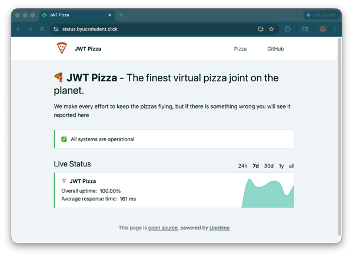
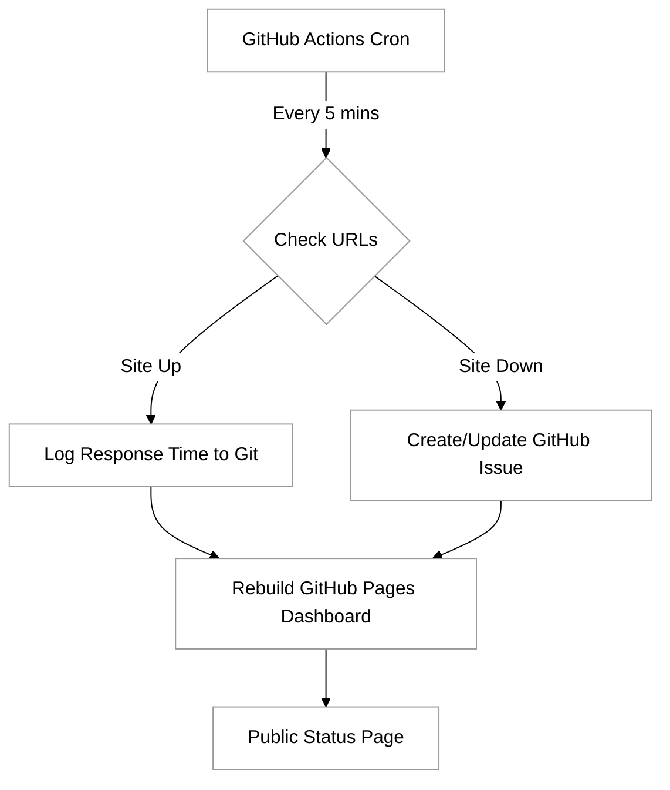

# Upptime

[Upptime](https://github.com/upptime/upptime) is a free, easy-to-configure status solution that leverages GitHub's infrastructure. It uses a scheduled GitHub Actions workflow to monitor your website and updates GitHub Pages to display the current status. GitHub Issues are used to track incidents, and the results are automatically integrated into the [status page](https://demo.upptime.js.org/).  This **serverless** approach makes it a highly cost-effective and resilient choice for developers and small teams.



## Key Features of Upptime

- **GitHub Actions as Monitors:** Uses cron schedules to ping your APIs and websites every few minutes.
- **Incident Reports via Issues:** Automatically documents downtime using the repository's issue tracker.
- **Dynamic Status Page:** Generates a beautiful, accessible website using React that displays response times and uptime graphs.
- **Notifications:** Supports integrated alerts through platforms like Slack, Discord, Telegram, and SMS.
- **No Infrastructure Costs:** Since it runs on GitHub’s free tier for public repositories, you don't have to manage servers or databases.

## Upptime architecture

Upptime functions by using GitHub Actions as a **cron** service. Every few minutes, a workflow triggers a script that fetches your configured URLs. If a site is down, the workflow automatically opens a GitHub Issue to record the incident and uses Git to commit the response time data to your repository. Once the service is restored, the Action closes the issue, and the statistics are updated on your public-facing status page.

The following diagram illustrates the core workflow of how Upptime functions within the GitHub ecosystem:



## Key Implementation Steps

Implementing Upptime involves four primary steps to ensure the automation has the permissions it needs to manage your status data:

1.  **Template Setup**: You begin by forking the official Upptime template repository. This repository contains the workflows and the frontend code for the status page.
2.  **Repository Secrets**: Because GitHub Actions needs to commit data back to your repository and create issues, you must generate a **Personal Access Token (PAT)** with `repo` and `workflow` scopes and add it as a secret named `GH_PAT`.
3.  **Configuration**: All monitoring logic is handled in a single file: `.upptimerc.yml`. Here you define the sites to monitor, the frequency of checks, and the branding for your status page.
4.  **Deployment**: Once configured, the `Setup` workflow runs, initializing the data folder and deploying the static site to GitHub Pages.

## Detailed Implementation Steps

### 1. Create the Repository from the Template

Upptime is designed to be used as a GitHub template. This ensures you have the necessary workflow files and directory structure.

1.  Navigate to the [Upptime template repository](https://github.com/upptime/upptime).
2.  Click the **Use this template** button and select **Create a new repository**.
3.  Choose a name for your repository (e.g., `status-page`).
4.  Ensure the repository visibility is set to **Public**. GitHub Actions and GitHub Pages are free for public repositories.
5.  Click **Create repository from template**.

### 2. Generate a Personal Access Token (PAT)

Because GitHub Actions needs to commit status updates and manage issues within your repository, you must provide a Personal Access Token with elevated permissions.

1.  Go to your GitHub **Settings** > **Developer settings** > **Personal access tokens** > **Tokens (classic)**.
2.  Click **Generate new token (classic)**.
3.  Set the Note to `Upptime PAT`.
4.  Select the following scopes:
    - `repo` (Full control of private and public repositories)
    - `workflow` (Update GitHub Action workflows)
5.  Click **Generate token** and copy the value immediately.

### 3. Configure Repository Secrets

To keep your PAT secure, you must store it as an encrypted secret in your repository.

1.  In your new Upptime repository, navigate to **Settings** > **Secrets and variables** > **Actions**.
2.  Click **New repository secret**.
3.  Name the secret `GH_PAT`.
4.  Paste your Personal Access Token into the **Secret** field.
5.  Click **Add secret**.

### 4. Customize the Configuration File

The `.upptimerc.yml` file is the central configuration hub for your status page. This is where you define which endpoints to monitor.

1.  Open `.upptimerc.yml` in the root of your repository.
2.  Update the `owner` and `repo` fields to match your GitHub username and repository name.
3.  Define the sites you want to monitor under the `sites` key:
    ```yaml
    sites:
      - name: Google
        url: https://www.google.com
      - name: My Website
        url: https://example.com
    ```
4.  Commit these changes directly to the `master` or `main` branch.

### 5. Enable GitHub Pages

Upptime automatically generates a static website to serve as your status page. You must configure GitHub to host this site.

1.  Wait for the first GitHub Action workflow to complete (this happens automatically after your first commit).
2.  Navigate to **Settings** > **Pages**.
3.  Under **Build and deployment** > **Branch**, select `gh-pages` and the `/ (root)` folder.
4.  Click **Save**.
5.  Your status page will soon be live at `https://<username>.github.io/<repository-name>/`.

### 6. Understanding the Monitoring Workflow

Once configured, Upptime operates using the following automated logic:

- **Uptime Monitoring:** A GitHub Action runs every 5 minutes (configurable) to check the status of your sites using `curl`.
- **Incident Reporting:** If a site is down, Upptime automatically opens a GitHub Issue to log the downtime. When the site returns to an "up" state, the issue is automatically closed.
- **Data Persistence:** Response times and status history are committed to the `data` branch, which serves as a lightweight database.
- **Static Site Generation:** The status page UI is rebuilt periodically to reflect the latest data from the monitoring checks.

## Configuration Example

The `.upptimerc.yml` file is the heart of your implementation. Below is an example of a basic configuration monitoring two different endpoints:

```yaml
# .upptimerc.yml
owner: your-username
repo: your-status-repo

sites:
  - name: Main Website
    url: https://example.com
  - name: API Gateway
    url: https://api.example.com/v1/health
    method: GET
    # You can even check for specific status codes
    expectedStatusCode: 200

status-website:
  # The configuration for your public-facing dashboard
  title: My Service Status
  logoUrl: https://raw.githubusercontent.com/upptime/logo/master/logo.png
  name: 'Service Status'
  introMessage: This page monitors our core infrastructure.
  navbar:
    - title: Status
      href: /
    - title: GitHub
      href: https://github.com/your-username/your-status-repo
```

## Monitoring Strategy

When implementing Upptime, consider the following best practices:

- **Check Intervals**: While GitHub Actions allows frequent runs, setting the interval too low (e.g., every 1 minute) may lead to rate limiting or high usage of Action minutes. A 5-minute interval is usually sufficient for most status pages.
- **Response Time Analysis**: Upptime creates graphs of response times. Ensure your endpoints are lightweight so the monitoring itself doesn't skew your performance data.
- **Issue Labels**: Upptime uses labels like `status` and `down` to categorize incidents. You can subscribe to these labels on GitHub to receive notifications on your phone or via email whenever a service goes down.

```masteryls
{"id":"5af2ba18-c779-4172-89e3-e4b256fa5d03","title":"Understanding Upptime Infrastructure","type":"multiple-choice"}
How does Upptime record a service outage and notify users?

- [ ] It uses a dedicated SQL database to store downtime logs and sends emails via SendGrid.
  You might be thinking of traditional monitoring tools. Upptime is "serverless" and does not use a SQL database; it stores all data directly in your GitHub repository using Git commits.
- [ ] It requires a persistent background process running on a VPS to ping the configured URLs.
  Actually, Upptime avoids the need for a VPS entirely by using GitHub Actions workflows, which run on GitHub's hosted runners on a scheduled cron trigger.
- [ ] It updates a local JSON file via a web-hook and requires manual approval to show an outage on the status page.
  While Upptime does store data in files, the process is fully automated. It does not require manual approval to report an outage, ensuring your status page reflects the real-time state of your services.
- [x] It uses GitHub Actions to detect failures and automatically opens GitHub Issues to track the downtime.
  Correct! By using GitHub Issues as the incident management system, Upptime provides a transparent, version-controlled history of all outages without needing external databases.
```
