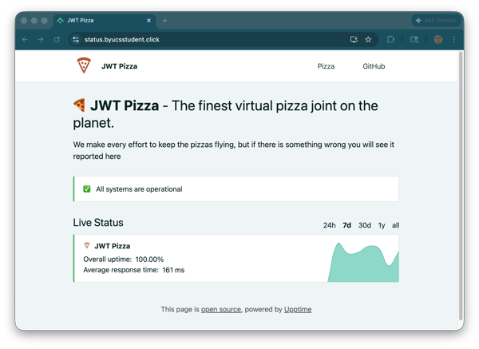
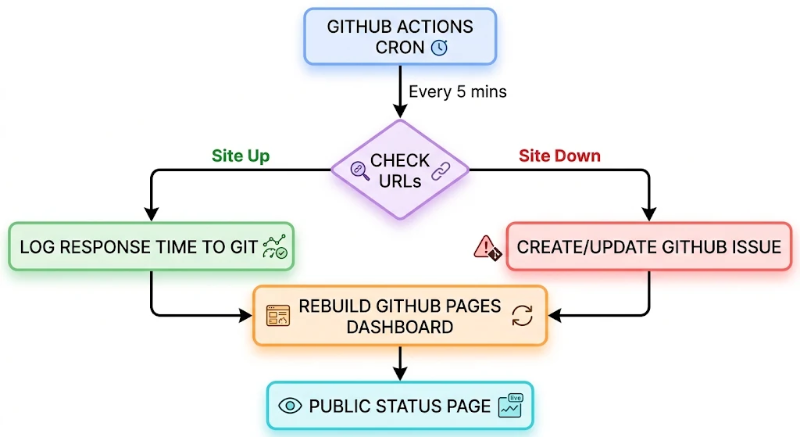
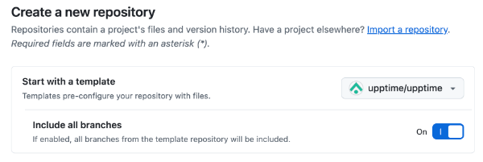
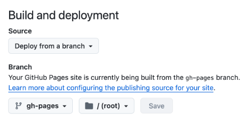
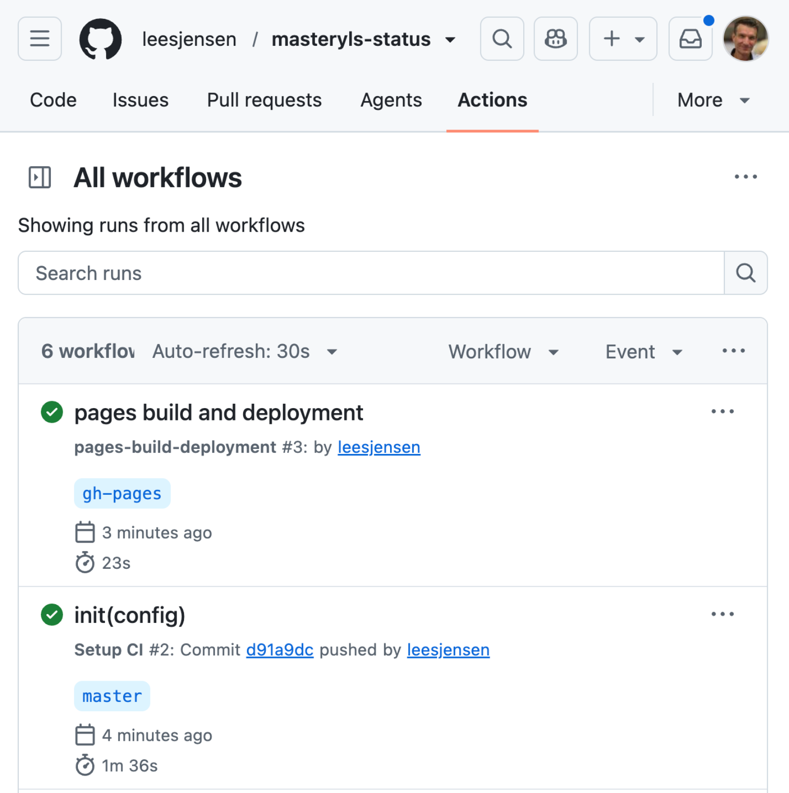

# Upptime

[Upptime](https://github.com/upptime/upptime) is a free, easy-to-configure status solution that leverages GitHub's infrastructure. It uses a scheduled GitHub Actions workflow to monitor your website and updates GitHub Pages to display the current status. GitHub Issues are used to track incidents, and the results are automatically integrated into the [status page](https://demo.upptime.js.org/).  This **serverless** approach makes it a highly cost-effective and resilient choice for developers and small teams.



## Key Features of Upptime

- **GitHub Actions as Monitors:** Uses cron schedules to ping your APIs and websites every few minutes.
- **Incident Reports via Issues:** Automatically documents downtime using the repository's issue tracker.
- **Dynamic Status Page:** Generates a beautiful, accessible website using React that displays response times and uptime graphs.
- **Notifications:** Supports integrated alerts through platforms like Slack, Discord, Telegram, and SMS.
- **No Infrastructure Costs:** Since it runs on GitHub’s free tier for public repositories, you don't have to manage servers or databases.

## Upptime architecture

Upptime functions by using GitHub Actions as a **cron** service. Every few minutes, a workflow triggers a script that fetches your configured URLs. If a site is down, the workflow automatically opens a GitHub Issue to record the incident and uses Git to commit the response time data to your repository. Once the service is restored, the Action closes the issue, and the statistics are updated on your public-facing status page.

The following diagram illustrates the core workflow of how Upptime functions within the GitHub ecosystem:



## Implementation Steps

Implementing Upptime involves six primary steps to ensure the automation has the permissions it needs to manage your status data.

### 1. Create the Repository from the Template

Upptime is designed to be used as a GitHub template. This ensures you have the necessary workflow files and directory structure.

1.  Initiate the creation of your Upptime repository using the [Upptime template](https://github.com/new?template_name=upptime&template_owner=upptime).
1.  Choose a name for your repository (e.g., `status-page`).
1. Select the option to include all branches. This is necessary in order to include all of the starting code.
  
1.  Ensure the repository visibility is set to **Public**. GitHub Actions and GitHub Pages are free for public repositories.
1.  Click **Create repository**.

### 2. Enable GitHub Pages

Upptime automatically generates a static website to serve as your status page. You must configure GitHub Pages to host this site.

1. Add a DNS record to your DNS hostname records.
    ```txt
    status.yourdomainname
    CNAME
    yourgithubaccount.github.io
    ```
1.  Navigate to **Settings** > **Pages**.
1.  Under **Build and deployment** > **Branch**, verify, or select, `gh-pages` and the `/ (root)` folder.
    
1. Click **Save** if not already set.
1. Set your status custom domain such as `status.yourdomainhere`. Once GitHub validates the name against your DNS server it should say **DNS check successful**.

### 3. Generate a Personal Access Token (PAT)

Because GitHub Actions needs to commit status updates and manage issues within your repository, you must provide a Personal Access Token with elevated permissions.


Click on your profile picture on the top-right corner and select "Settings"
In the left sidebar, select "Developer settings"
In the left sidebar, click "Personal access tokens" > "Fine-grained tokens"
Click "Generate new token"
Give your token a specific distinct name
In the "Expiration" dropdown, select "90 days" or a custom, longer expiry
In the "Resource Owner" section select the user or organization your Upptime repository belongs to
In the "Repository Access" section select "Only select repositories" and select your Upptime repository
In the "Permissions" > "Repository permissions" section enable read-write access to Actions, Contents, Issues and Workflows
Skip the "Organization permissions" section
Click "Generate token" or "Generate token and request access" (if it is in an org you are not an admin of)

1. Go to GitHub **Settings** > **Developer settings** > **Personal access tokens** > **Fine-gramed tokens**.
1. Click **Generate new token**.
1. Give your token a specific distinct name such as _Upptime_.
1. In the "Resource Owner" section select the user or organization your Upptime repository belongs to
1. In the "Expiration" dropdown, select "90 days" or a custom, longer expiry
1. In the "Repository Access" section select "Only select repositories" and select your Upptime repository
1. In the **Permissions**, select the following **read/write** scopes for the following:
   - Actions
   - Contents
   - Issues
   - Workflows
1.  Click **Generate token** and copy the value immediately.

### 3. Configure Repository Secrets

To keep your PAT secure, you must store it as an encrypted secret in your repository.

1.  In your new Upptime repository, navigate to **Settings** > **Secrets and variables** > **Actions**.
2.  Click **New repository secret**.
3.  Name the secret `GH_PAT`.
4.  Paste your Personal Access Token into the **Secret** field.
5.  Click **Add secret**.

### 4. Customize the Configuration File

The `.upptimerc.yml` file is the central configuration hub for your status page. This is where you define which endpoints to monitor.

1.  Open `.upptimerc.yml` in the root of your repository.
2.  Update the **owner** and **repo** fields to match your GitHub username and repository name.
3.  Replace the sites with your JWT pizza site.
1. Update the **status-website** fields with the appropriate values.
1. Review your changes. (Replace `yourdomainname` with your domain name.)

    ```yaml
    owner: leesjensen # Your GitHub organization or username, where this repository lives
    repo: masteryls-status # The name of this repository

    sites:
      - name: JWT Pizza
        url: https://pizza.yourdomainname

    assignees: # Users to assign downtime issues (optional)
      - leesjensen

    status-website:
      cname: status.yourdomainname
      logoUrl: https://pizza.yourdomainname/jwt-pizza-icon.png
      name: JWT Pizza Status
      introTitle: '**JWT Pizza** The ultimate online pizza service'
      introMessage: "Providing you up to date status for your favorite Pizza website."
      navbar:
        - title: Status
          href: /
        - title: GitHub
          href: https://github.com/$OWNER/$REPO
    ```
4.  Commit these changes directly to the `master` branch. This will trigger the actions that build, monitory, and update your status website. You can validate that it is working by viewing the `Actions` workflows.

    

After the successful completion of all the steps you should be able to view your status website at the domain that you provided.


## Understanding the Monitoring Workflow

Once configured, Upptime operates using the following automated logic:

- **Uptime Monitoring:** A GitHub Action runs every 5 minutes (configurable) to check the status of your sites using `curl`.
- **Incident Reporting:** If a site is down, Upptime automatically opens a GitHub Issue to log the downtime. When the site returns to an "up" state, the issue is automatically closed.
- **Data Persistence:** Response times and status history are committed to the `data` branch, which serves as a lightweight database.
- **Static Site Generation:** The status page UI is rebuilt periodically to reflect the latest data from the monitoring checks.

## Monitoring Strategy

When implementing Upptime, consider the following best practices:

- **Check Intervals**: While GitHub Actions allows frequent runs, setting the interval too low (e.g., every 1 minute) may lead to rate limiting or high usage of Action minutes. A 5-minute interval is usually sufficient for most status pages.
- **Response Time Analysis**: Upptime creates graphs of response times. Ensure your endpoints are lightweight so the monitoring itself doesn't skew your performance data.
- **Issue Labels**: Upptime uses labels like `status` and `down` to categorize incidents. You can subscribe to these labels on GitHub to receive notifications on your phone or via email whenever a service goes down.

```masteryls
{"id":"5af2ba18-c779-4172-89e3-e4b256fa5d03","title":"Understanding Upptime Infrastructure","type":"multiple-choice"}
How does Upptime record a service outage and notify users?

- [ ] It uses a dedicated SQL database to store downtime logs and sends emails via SendGrid.
  You might be thinking of traditional monitoring tools. Upptime is "serverless" and does not use a SQL database; it stores all data directly in your GitHub repository using Git commits.
- [ ] It requires a persistent background process running on a VPS to ping the configured URLs.
  Actually, Upptime avoids the need for a VPS entirely by using GitHub Actions workflows, which run on GitHub's hosted runners on a scheduled cron trigger.
- [ ] It updates a local JSON file via a web-hook and requires manual approval to show an outage on the status page.
  While Upptime does store data in files, the process is fully automated. It does not require manual approval to report an outage, ensuring your status page reflects the real-time state of your services.
- [x] It uses GitHub Actions to detect failures and automatically opens GitHub Issues to track the downtime.
  Correct! By using GitHub Issues as the incident management system, Upptime provides a transparent, version-controlled history of all outages without needing external databases.
```
