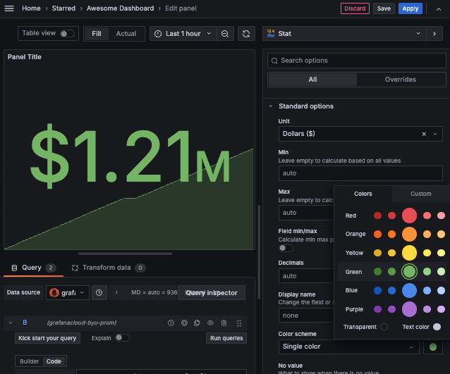
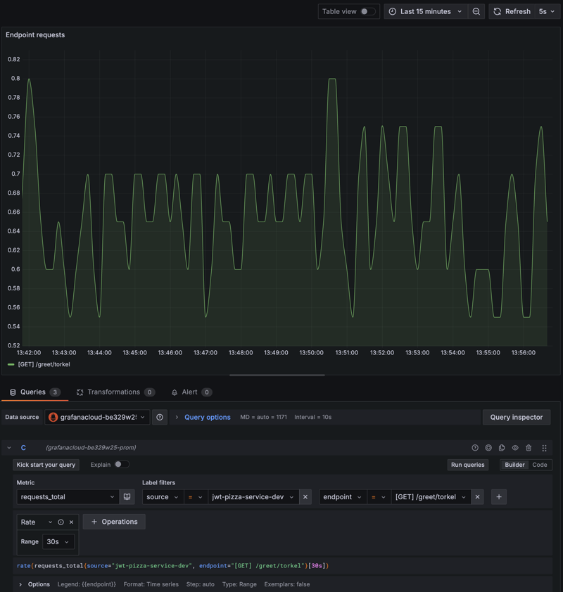
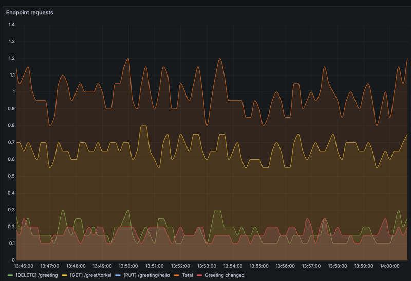

# Example website metrics

🔑 **Key points**

- Create a simple website and simulate traffic to it.
- Experiment with creating visualizations based on generated data.

---

Gaining proficiency with metric insertion and visualization takes practice. You should spend time both inserting data and experimenting with the visualization options that have made Grafana a standard for observability.



For this course, we focus primarily on visualizing service metrics. Let's walk through the basic concepts required to build your JWT Pizza dashboard.

## A simple web service

Start by creating a simple web service with a single endpoint.

1.  Open your terminal.
2.  Execute the following commands:

    ```sh
    mkdir metricsExample && cd metricsExample
    npm init -y
    npm install express
    ```

3.  Modify the `package.json` file to include a start script:

    ```json
    "scripts": {
      "start": "node index.js"
    },
    ```

4.  Create an `index.js` file containing a simple service that returns a greeting:

    ```js
    const express = require('express');
    const app = express();

    let greeting = 'hello';

    app.get('/greet/:name', (req, res) => {
      res.send({ [greeting]: req.params.name });
    });

    app.listen(3000, function () {
      console.log(`Listening on port 3000`);
    });
    ```

5.  Create a `config.js` file to store your Grafana credentials, similar to the [Grafana Metrics](../grafanaMetrics/grafanaMetrics.md#generating-data-with-javascript) instruction.
6.  Create a `metrics.js` file. This script uses a `sendMetricToGrafana` function similar to the one created previously, but it is enhanced to send multiple metrics in a single request and parameterize the OpenTelemetry (OTel) request using labels.

    The application supplies metrics in two ways:
    - The `greetingChanged` function increments a counter whenever the greeting is updated.
    - The `requestTracker` Express middleware tracks hits to specific endpoints.

    The script uses `setInterval` to aggregate and send these metrics to Grafana every 10 seconds.

    ```js
    const config = require('./config');

    // Metrics stored in memory
    const requests = {};
    let greetingChangedCount = 0;

    // Function to track when the greeting is changed
    function greetingChanged() {
      greetingChangedCount++;
    }

    // Middleware to track requests
    function requestTracker(req, res, next) {
      const endpoint = `[${req.method}] ${req.path}`;
      requests[endpoint] = (requests[endpoint] || 0) + 1;
      next();
    }

    // Periodically send metrics to Grafana
    setInterval(() => {
      const metrics = [];
      Object.keys(requests).forEach((endpoint) => {
        metrics.push(createMetric('requests', requests[endpoint], '1', 'sum', 'asInt', { endpoint }));
      });

      metrics.push(createMetric('greetingChange', greetingChangedCount, '1', 'sum', 'asInt', {}));

      sendMetricToGrafana(metrics);
    }, 10000);

    function createMetric(metricName, metricValue, metricUnit, metricType, valueType, attributes) {
      attributes = { ...attributes, source: config.source };

      const metric = {
        name: metricName,
        unit: metricUnit,
        [metricType]: {
          dataPoints: [
            {
              [valueType]: metricValue,
              timeUnixNano: Date.now() * 1000000,
              attributes: [],
            },
          ],
        },
      };

      Object.keys(attributes).forEach((key) => {
        metric[metricType].dataPoints[0].attributes.push({
          key: key,
          value: { stringValue: attributes[key] },
        });
      });

      if (metricType === 'sum') {
        metric[metricType].aggregationTemporality = 'AGGREGATION_TEMPORALITY_CUMULATIVE';
        metric[metricType].isMonotonic = true;
      }

      return metric;
    }

    function sendMetricToGrafana(metrics) {
      const body = {
        resourceMetrics: [
          {
            scopeMetrics: [
              {
                metrics,
              },
            ],
          },
        ],
      };

      fetch(`${config.endpointUrl}`, {
        method: 'POST',
        body: JSON.stringify(body),
        headers: { Authorization: `Bearer ${config.accountId}:${config.apiKey}`, 'Content-Type': 'application/json' },
      })
        .then((response) => {
          if (!response.ok) {
            throw new Error(`HTTP status: ${response.status}`);
          }
        })
        .catch((error) => {
          console.error('Error pushing metrics:', error);
        });
    }

    module.exports = { requestTracker, greetingChanged };
    ```

7.  Modify `index.js` to import the metrics module and apply the `requestTracker` middleware to the greeting endpoint:

    ```js
    const metrics = require('./metrics');

    // ... existing code ...

    app.get('/greet/:name', metrics.requestTracker, (req, res) => {
      res.send({ [greeting]: req.params.name });
    });
    ```

## Generate data

Start your service:

```sh
npm run start
```

Use a `curl` command to repeatedly hit the greeting endpoint:

```sh
while true; do curl localhost:3000/greet/torkel; sleep 1; done;
```

## Create the visualization

Once the data is flowing, create a visualization to display the request count.

1.  Open your Grafana dashboard.
2.  Create a **New visualization**.
3.  In **Query options**, set the **Min interval** to `10s`.
4.  Select the `requests_total` metric and add a label filter where `source` equals `jwt-pizza-service-dev`.
5.  Add a `Rate` operation using a **Range** of `30s`.
6.  In the **Legend** settings, choose **Custom** and enter `{{endpoint}}`.
7.  Experiment with the visualization styles (e.g., Time series, Bar gauge) to make the graph more informative.



## ☑ Exercise

You should now have a foundational understanding of how to generate metrics in JavaScript and visualize them in Grafana. To deepen your knowledge, complete the following:

1.  **Modify the service code:**
    1.   Add a `PUT /greeting/:greeting` endpoint that updates the `greeting` variable. Apply the `metrics.requestTracker` middleware and call `metrics.greetingChanged()` within the route handler.
    1.   Add a `DELETE /greeting` endpoint that resets the greeting to its default value. Apply the `metrics.requestTracker` middleware.
2.  **Generate traffic:** Use the [generateMetricTraffic.sh](exampleCode/generateMetricTraffic.sh) shell script to automate requests to all available endpoints.
3.  **Update the dashboard:** Modify your visualization to show a series for **each endpoint** as well as a **total** request count. Add a separate visualization or series to track the rate at which the greeting is changed.

When finished, your dashboard should look similar to this:

